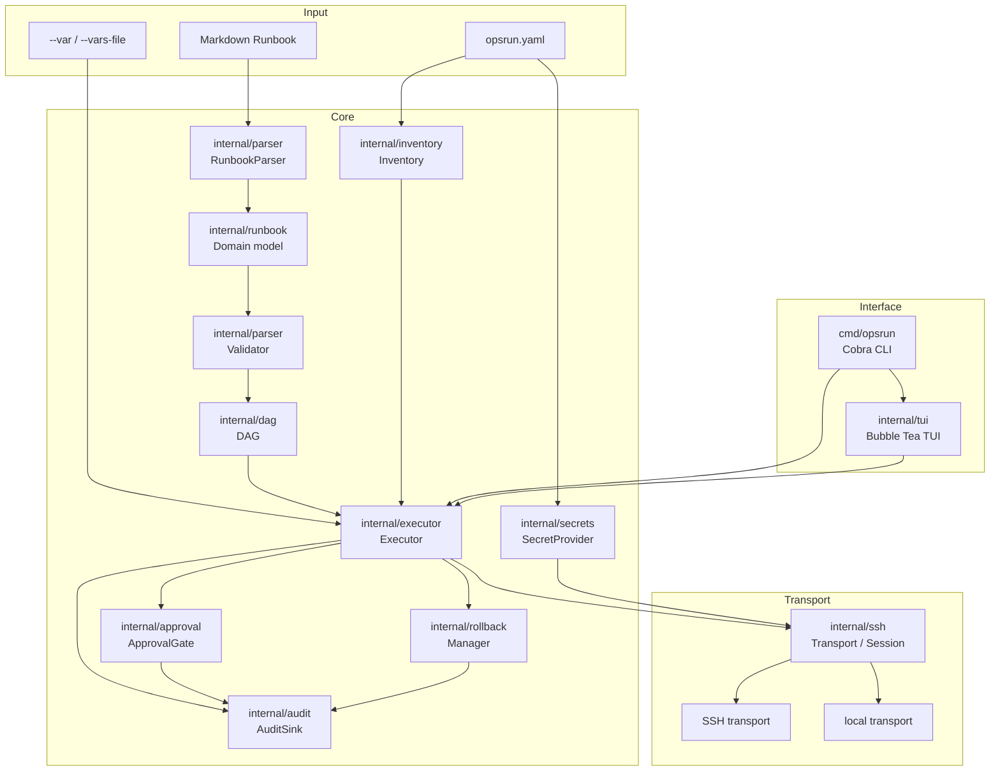
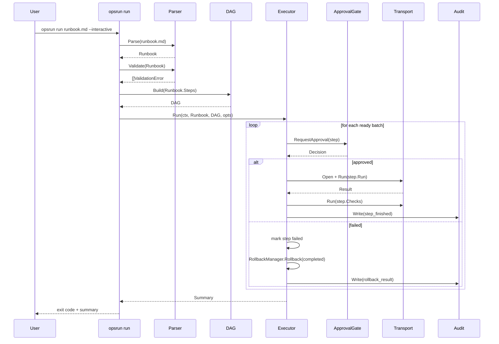
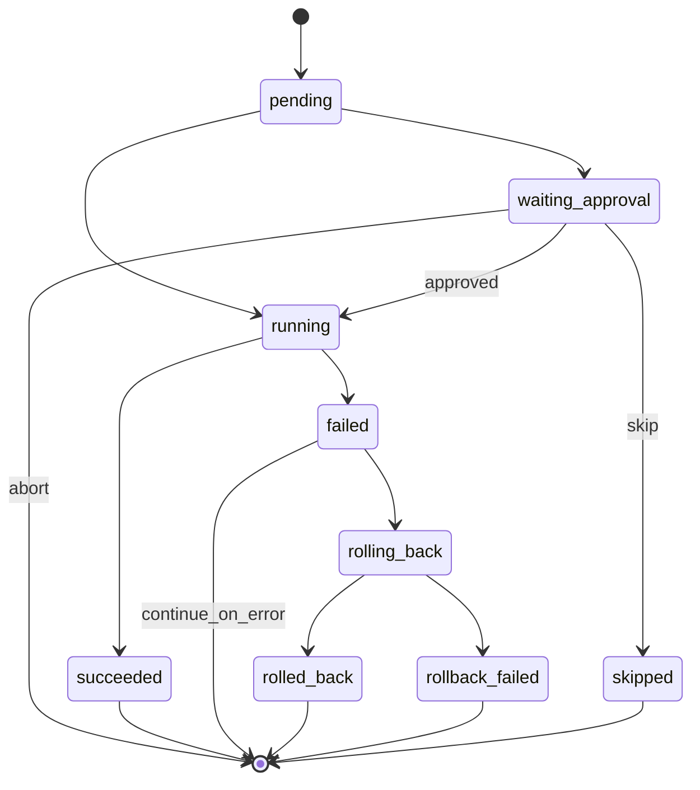

# Architecture

OpsRun turns a Markdown runbook into a validated DAG of steps, then executes that DAG
against remote hosts through a pluggable transport, with approval gates, automatic
rollback, and an immutable audit trail.

## Components

## Execution flow

## State machine

Each step has an independent state per target host. Valid transitions:

The full set of transitions, including checkpointing for `opsrun resume`, is implemented
and tested in Phase 4 (`internal/executor`).

## Package boundaries

- `internal/runbook`: the domain model only. No I/O, no dependencies on other `internal`
  packages except the standard library.
- `internal/parser`: turns Markdown into `internal/runbook` values, and validates them.
  Depends only on `internal/runbook` and goldmark.
- `internal/inventory`: resolves host and group names to connection parameters. No
  dependency on transport or execution.
- `internal/ssh`: the `Transport`/`Session` abstraction, the SSH implementation, and the
  local implementation. Depends on `internal/inventory` for host parameters only.
- `internal/dag`: pure graph algorithms over `internal/runbook.Step`. No I/O.
- `internal/executor`: orchestrates `internal/dag`, `internal/ssh`, `internal/approval`,
  `internal/rollback`, and `internal/audit` to run a validated runbook.
- `internal/approval`, `internal/rollback`, `internal/audit`, `internal/secrets`: focused,
  independently testable interfaces consumed by the executor.
- `internal/config`: parses and validates `opsrun.yaml` and translates it into the types
  the other packages need (for example `inventory.Host`).
- `internal/tui` and `cmd/opsrun`: user-facing layers; they depend on the packages above,
  never the other way around.

This keeps every package testable in isolation with fakes for its dependencies, which is
how the SSH worker pool (Phase 3) and the execution engine (Phase 4) are tested without a
real network or real remote hosts.
